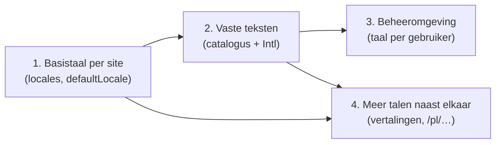

# Ontwerp — meertaligheid (W5/S9)

Status: **stap A gebouwd (20-11-2026), stap B voor een deel** (zie §3), C en
D ontwerp. De keuzes
in §7 zijn besloten op 20-11-2026. Vervangt het denkstuk van juli 2026 (dat
ging alleen over vertalingen van inhoud, met Engels als bron; het staat nu in
§5, bijgewerkt).

Aanleiding: vrienden in Polen willen een site, deels zonder Engels. Een
eentalige Poolse site moet dus echt Pools zijn: inhoud, vaste teksten,
datums, en liefst ook de beheeromgeving.

## 1. Vier lagen

| Laag | Wat | Nu | Nodig voor een Poolse site |
|---|---|---|---|
| 1. Basistaal | in welke taal de inhoud van een site staat | Engels is hard de basis (`pickLang`); de schema's kennen alleen `en` en `nl` | ja |
| 2. Vaste teksten publiek | knoppen, datums, inlog-, zoek- en accountpagina's | door elkaar Engels en Nederlands, in de code | ja |
| 3. Beheeromgeving | de admin en de studio | Engels met Nederlandse stukken | als de redactie geen Engels leest |
| 4. Meer talen naast elkaar | vertalingen per item, `/pl/…`, taalkeuze | opslag kan het (`lang` per rij), site en admin niet | nee |

Laag 1 en 2 maken een site **eentalig in elke taal**. Laag 3 maakt het
**beheer** meertalig. Laag 4 maakt een site **meertalig**. Ze bouwen op
elkaar, maar 3 en 4 zijn los van elkaar.



## 2. Laag 1 — basistaal per site

**Nu.** Elk item heeft `lang` (kolom in `content_items`, deel van de sleutel
`type + slug + lang`). Lezen kiest per slug de `en`-rij en legt de gevraagde
taal eroverheen. `Locale` is `z.enum(["en", "nl"])`. De siteconfig heeft al
`defaultLocale`, maar alleen de RSS-feed van MusicBrain leest hem. Gevolg:
de Nederlandse sites slaan Nederlandse tekst op als `en`, en een in de studio
als `nl` opgeslagen pagina geeft een 404 (gezien 30-09).

**Voorstel.**
- `Locale` wordt een taalcode (`z.string().regex(/^[a-z]{2}$/)`), en de
  siteconfig krijgt `locales: string[]` naast `defaultLocale`. Welke talen
  een site kent, is een instelling, geen schemawijziging.
- `pickLang` valt terug op de **basistaal van de site** in plaats van op
  `en`: volgorde *gevraagde taal → `defaultLocale` → `en`* (de laatste stap
  alleen voor bestaande data, zie keuze B).
- Schrijven zonder taal gebruikt `defaultLocale` (nu: `"en"` in
  `putItem`, `getItem`, `deleteItem`, `listVersions` en de `emptyData` van
  elk type).
- `<html lang>` en datumnotatie komen uit `defaultLocale` (nu vast in elke
  `layout.tsx`).
- De studio kiest standaard de basistaal en waarschuwt bij een taal die de
  site niet toont (backlog-punt van 30-09).

**Zo gebouwd (stap A, 20-11-2026).** Op drie punten anders dan het voorstel:
- `locales` en `defaultLocale` staan in **`imprint.config.ts`**, niet in de
  siteconfig in de store. De store moet de basistaal kennen vóór hij iets
  leest, en de siteconfig is zelf inhoud uit die store. Het veld
  `defaultLocale` in de siteconfig bestaat nog (de RSS-feed van MusicBrain
  leest het), maar de config is leidend.
- De basistaal geldt voor de **typen die de store per taal leest**: pagina,
  product, component en board-spec (`LANGUAGE_TYPES` in `content-core/src/lang.ts`).
  Menu's, thema's, beelden en de typen van plugins hebben geen eigen taal;
  hun rijen houden het etiket `en`. Menu's per taal horen bij laag 4.
- Een site zonder `defaultLocale` in haar config blijft op `en` staan en
  merkt niets van de wijziging.

De terugval *gevraagd → basistaal → `en`* zit in `pickByLang`. De laatste stap
vindt rijen van vóór de basistaal; zodra een site echte Engelse vertalingen
heeft (laag 4) moet hij eruit, anders komt een pagina die alleen in het Engels
bestaat ook op de Nederlandse site.

## 3. Laag 2 — vaste teksten op de publieke site

**Nu.** Een telling van zichtbare teksten in de code: runtime-admin ±120
(admin, laag 3), commonground-site ±35, plugin-wiki ±20, plugin-groups ±17,
widgets-standard ±13, de andere plugins elk 3–12. Datums met `nl-NL`, `en`
of `en-GB` vast in 14 plekken.

**Voorstel: een eigen kleine catalogus, geen i18n-bibliotheek.**
- Elk package dat zichtbare tekst heeft, krijgt `src/messages.ts`: één object
  per taal (`nl`, `en`, `pl`), met dezelfde sleutels, getypt op de
  Nederlandse of Engelse versie zodat een ontbrekende sleutel een
  compileerfout is.
  ```ts
  export const messages = {
    en: { previous: "Previous", next: "Next", allPosts: "All posts", postedOn: (d: string) => `Posted on ${d}` },
    nl: { previous: "Vorige", next: "Volgende", allPosts: "Alle berichten", postedOn: (d) => `Geplaatst op ${d}` },
    pl: { previous: "Poprzedni", next: "Następny", allPosts: "Wszystkie wpisy", postedOn: (d) => `Opublikowano ${d}` },
  } satisfies Catalog;
  ```
- De taal komt via de context die er al is: `WidgetContext` krijgt
  `locale` (uit `readOptions`), plugin-routes lezen hem uit de siteconfig.
  Een helper `t(messages, locale)` geeft het object, met terugval op `en`.
- Datums en getallen via `Intl` met de locale van de site; één helper
  (`formatDate(locale, d, stijl)`) in `content-core`, zodat er geen vaste
  `nl-NL` meer in de code staat.
- Een site kan teksten **overschrijven** (een eigen woord voor "Berichten"):
  de siteconfig krijgt `messages?: Record<string, string>` per taal. Later,
  niet nodig voor Polen.
- Een test per package: alle talen hebben dezelfde sleutels.

**Zo gebouwd (stap B, eerste deel, 20-11-2026).**
- `content-core/src/messages.ts`: het type `Catalog<T>` (Engels verplicht, een
  taal die een sleutel mist compileert niet), `messagesFor(catalogus, taal)`
  met terugval op Engels, en `formatDate(taal, datum, stijl)`.
- De taal van de vaste teksten is een eigen instelling: **`uiLocale`** in
  `imprint.config.ts`, standaard de basistaal. Zo krijgt een Nederlandse site
  Nederlandse knoppen zonder dat haar inhoud een ander etiket hoeft
  (commonground). De site geeft hem door als `WidgetContext.locale`; een site
  met meer talen kan dat later per verzoek doen.
- Catalogi in `nl`, `en` en `pl`: de standaardwidgets
  (`widgets-standard/src/messages.ts`) en de zoekpagina van de engine
  (`runtime-admin/src/messages.ts`). De kop en voet van de Imprint-site
  (`sites/imprint/src/messages.ts`) in `nl` en `en`.
- Client-eilanden (carrousel, inhoudsopgave) krijgen hun teksten als gewone
  data van de viewer; ze importeren geen catalogus.
- Wat een redacteur ziet als een widget nog niet is ingesteld ("Paste a V3
  model…") is beheer en hoort bij laag 3.

**Nog te doen in stap B.**
- De plugins van de community (groepen, blog, evenementen, annotaties, wiki,
  begrippen) hebben hun teksten in het Nederlands in de code, veel meer dan de
  telling hierboven: ook formulieren en foutmeldingen. Alleen commonground
  gebruikt ze. Omzetten naar een catalogus per plugin zodra een site ze in een
  andere taal nodig heeft.
- De datums in die plugins (`nl-NL` vast) naar `formatDate`; de blog gebruikt
  hem al.
- De plugins presentations en omnium, voor omnium en inrichting.
- Inlog- en accountpagina's voor leden.
- Datums in de standaardwidgets (berichten, tijdlijn) staan er als ruwe
  ISO-datum; bewust niet veranderd, want dat wijzigt wat MusicBrain toont.

Waarom geen `next-intl` of i18next: de packages moeten framework-vrij blijven
(`extension-api`, de stores), de hoeveelheid tekst is klein, en de taal komt
per site, niet per verzoek (behalve in laag 4). Een eigen catalogus is een
paar honderd regels en volledig getypt.

## 4. Laag 3 — de beheeromgeving

- Dezelfde catalogus in `runtime-admin` (±120 teksten, plus de schermen van
  plugins in de admin).
- **Taal per gebruiker**: een veld `locale` bij de gebruiker (keuze onder
  *Account*), standaard de basistaal van de site. Zo kan een Poolse redacteur
  Pools werken en Mark Nederlands op dezelfde site.
- **Formulieren**: `SchemaForm` maakt labels nu uit veldnamen. Per contenttype
  komt een labelkaart per taal (`labels: { pl: { title: "Tytuł", … } }`) naast
  het schema; zonder kaart blijft het de veldnaam. Zo hoeft het zod-schema
  zelf niet te veranderen.
- **De widgetcatalogus** in de studio: de naam van een widget blijft één naam
  (Hero, Cards; zo staan ze ook in het document voor opdrachtgevers), de
  hulptekst (ⓘ) en de labels van de velden gaan wel mee in de vertaling.
- Foutmeldingen van zod: een vertaalde `errorMap` per taal.

Dit is de grootste laag. Ze kan in stukken: eerst de schermen die een
redacteur dagelijks ziet (pagina's, studio, media, menu's), dan de rest.

## 5. Laag 4 — meer talen naast elkaar

Het plan van juli blijft staan, met één wijziging: **niet Engels maar de
basistaal is de bron.**

- **Een vertaling is een eigen item**: zelfde `type` + `slug`, ander `lang`,
  met een eigen bitemporale historie. Technische velden (versies, connectors,
  kleurtokens) zijn taalloos; alleen tekst verschilt.
- **Admin**: taaltabs boven het formulier en in de studio; in een andere taal
  een knop **"Vertaling maken"** (kopieert de bron); een kolom
  *vertaald ✓ / —* in de lijsten.
- **Verouderde vertalingen** (de bonus van het bitemporele model): een
  vertaling is verouderd als de bron een nieuwere `txFrom` heeft; de editor
  toont het verschil sinds de vertaling (`listVersions` heeft die bron nog).
- **Site**: een padprefix voor de andere talen (`/en/…`), de basistaal zonder
  prefix, zodat bestaande adressen blijven werken. Een taalkeuze in de
  header, `hreflang` alleen voor vertalingen die bestaan. Geen taal uit een
  cookie (slecht voor zoekmachines).
- **Later en apart te besluiten**: voorvertalen met een LLM in de knop
  "Vertaling maken" (kosten, wie controleert).

**Wat de taaltraining erbij vraagt** (`sites/taal`, opgegeven door die sessie
op 20-11-2026). Die site lost het nu lokaal op en gaat als laatste over:
- Een **ingang** is daar de taal van de lezer plus een lespakket, niet alleen
  een taal: `pl` en `en` leren Nederlands, `nl` leert Pools. Menu, startpagina,
  naam en tagline in de kop hangen aan de ingang (`sites/taal/src/lib/ingang.ts`).
- Een tweede hostnaam die op een ingang opent, zonder `headers()` in de
  pagina, want alles blijft SSG.
- De interfacetaal staat los van de taal van de inhoud, en `<html lang>`
  volgt de ingang.
- Een pagina zonder taal in het adres hoort bij een ingang; als vertaling van
  één slug met de taal in het adres is dat netter.
- De taalkeuze in de kop verschilt per ingang, en wisselen houdt je op
  dezelfde les.
- **Niet overzetten**: lessen en grammatica. Die hebben de teksten per lezer
  in het item zelf (`dialoog { nl, pl, en }`) en zijn geen vertaalde items.
  Kandidaat zijn alleen pagina's, menu's, sitenaam en tagline en de vaste
  teksten.

## 6. Fasering

| Stap | Wat | Maat | Levert op |
|---|---|---|---|
| A | Laag 1: `locales`, basistaal in lezen en schrijven, `<html lang>`, waarschuwing in de studio. **Gebouwd 20-11-2026**, aangezet op de Imprint-site | S | Poolse inhoud correct opgeslagen en getoond |
| B | Laag 2: catalogi `nl/en/pl` in widgets-standard, de plugins en de site-chrome; `formatDate`. **Eerste deel gebouwd 20-11-2026**: de helpers, `uiLocale`, de standaardwidgets, de zoekpagina en de kop en voet van de Imprint-site; de plugins volgen | M | een volledig Poolse publieke site |
| C | Laag 3: admin-catalogus, taal per gebruiker, labelkaarten voor formulieren | L | Pools beheer |
| D | Laag 4: taaltabs, "Vertaling maken", dekking, `/en/`-prefix, `hreflang`, verouderd-melding | M + M + S | meertalige sites |

De Poolse site (de taaltraining) is er intussen, met een eigen oplossing in
de site. De volgorde is daarom (besloten 20-11-2026, zie keuze E): eerst de
engine, beproefd op de Imprint-site, dan inrichting en omnium, en de
taaltraining als laatste.

## 7. Keuzes (besloten 20-11-2026)

**A. Welke talen in de code?** *Besloten 8-11-2026: nl, en en pl.* Voorstel was: `nl`, `en` en `pl` nu; een vierde
taal is dan één catalogusbestand per package. De Poolse teksten vertaalt
Claude; iemand die Pools spreekt kijkt ze na voor de oplevering.

**B. Bestaande data die als `en` is opgeslagen maar Nederlands is**
(commonground, imprint, inrichting, omnium). *Besloten 20-11-2026:*
commonground blijft zoals het is (B1, geen `defaultLocale`; de organisatie
blijft bij Pleio). Imprint, inrichting en omnium krijgen B2: basis Nederlands,
en daarna een Engelse vertaling. Die vertaling heeft het etiket `en` nodig,
dus dat moet eerst vrij. Het script is `npm run db:relabel-lang -- --to=nl`
(op de VPS `./deploy.sh relabel-lang <site> --to=nl`); het raakt alleen de
typen met een taal.
- *B1 (voorstel)*: niets omzetten. De terugval *gevraagd → basistaal → `en`*
  vindt de oude rijen gewoon. Nieuwe opslagen krijgen de juiste taal.
  Nadeel: tot een item opnieuw wordt opgeslagen, klopt zijn label niet.
- *B2*: een script dat per site de `en`-rijen als nieuwe versie in de
  basistaal opslaat (via `WritableContentStore`, dus met historie). Schoon,
  maar raakt alle content; bij laag 4 alsnog nodig voor sites die echt
  tweetalig worden.

**C. Teksten overschrijven per site** (eigen woord voor "Berichten"): nu
meebouwen of later? Voorstel: later; de catalogus maakt het makkelijk.
*Nog open; speelt bij stap B.*

**D. Taal van de beheeromgeving.** Per gebruiker (voorstel) of per site? Per
gebruiker kost één veld en een keuzelijst, en laat een gemengde redactie
toe. *Nog open; speelt pas bij stap C.*

**E. Volgorde.** *Besloten 20-11-2026*, afgestemd met de sessie van de
taaltraining: de taalsites blijven voorlopig zoals ze zijn. De engine eerst,
op de Imprint-site: A (gebouwd), dan B, dan D met de Engelse vertaling van
Imprint. Daarna inrichting en omnium op dezelfde manier, en de taaltraining
als laatste (zie §5 voor wat zij erbij vraagt). C zodra een redactie geen
Engels leest.
