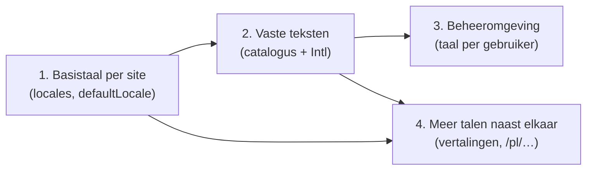

# Ontwerp — meertaligheid (W5/S9)

Status: **ontwerp, november 2026** — keuzes voor Mark in §7. Vervangt het
denkstuk van juli 2026 (dat ging alleen over vertalingen van inhoud, met
Engels als bron; het staat nu in §5, bijgewerkt).

Aanleiding: vrienden in Polen willen een site, deels zonder Engels. Een
eentalige Poolse site moet dus echt Pools zijn: inhoud, vaste teksten,
datums, en liefst ook de beheeromgeving.

## 1. Vier lagen

| Laag | Wat | Nu | Nodig voor een Poolse site |
|---|---|---|---|
| 1. Basistaal | in welke taal de inhoud van een site staat | Engels is hard de basis (`pickLang`); de schema's kennen alleen `en` en `nl` | ja |
| 2. Vaste teksten publiek | knoppen, datums, inlog-, zoek- en accountpagina's | door elkaar Engels en Nederlands, in de code | ja |
| 3. Beheeromgeving | de admin en de studio | Engels met Nederlandse stukken | als de redactie geen Engels leest |
| 4. Meer talen naast elkaar | vertalingen per item, `/pl/…`, taalkeuze | opslag kan het (`lang` per rij), site en admin niet | nee |

Laag 1 en 2 maken een site **eentalig in elke taal**. Laag 3 maakt het
**beheer** meertalig. Laag 4 maakt een site **meertalig**. Ze bouwen op
elkaar, maar 3 en 4 zijn los van elkaar.



## 2. Laag 1 — basistaal per site

**Nu.** Elk item heeft `lang` (kolom in `content_items`, deel van de sleutel
`type + slug + lang`). Lezen kiest per slug de `en`-rij en legt de gevraagde
taal eroverheen. `Locale` is `z.enum(["en", "nl"])`. De siteconfig heeft al
`defaultLocale`, maar alleen de RSS-feed van MusicBrain leest hem. Gevolg:
de Nederlandse sites slaan Nederlandse tekst op als `en`, en een in de studio
als `nl` opgeslagen pagina geeft een 404 (gezien 30-09).

**Voorstel.**
- `Locale` wordt een taalcode (`z.string().regex(/^[a-z]{2}$/)`), en de
  siteconfig krijgt `locales: string[]` naast `defaultLocale`. Welke talen
  een site kent, is een instelling, geen schemawijziging.
- `pickLang` valt terug op de **basistaal van de site** in plaats van op
  `en`: volgorde *gevraagde taal → `defaultLocale` → `en`* (de laatste stap
  alleen voor bestaande data, zie keuze B).
- Schrijven zonder taal gebruikt `defaultLocale` (nu: `"en"` in
  `putItem`, `getItem`, `deleteItem`, `listVersions` en de `emptyData` van
  elk type).
- `<html lang>` en datumnotatie komen uit `defaultLocale` (nu vast in elke
  `layout.tsx`).
- De studio kiest standaard de basistaal en waarschuwt bij een taal die de
  site niet toont (backlog-punt van 30-09).

## 3. Laag 2 — vaste teksten op de publieke site

**Nu.** Een telling van zichtbare teksten in de code: runtime-admin ±120
(admin, laag 3), commonground-site ±35, plugin-wiki ±20, plugin-groups ±17,
widgets-standard ±13, de andere plugins elk 3–12. Datums met `nl-NL`, `en`
of `en-GB` vast in 14 plekken.

**Voorstel: een eigen kleine catalogus, geen i18n-bibliotheek.**
- Elk package dat zichtbare tekst heeft, krijgt `src/messages.ts`: één object
  per taal (`nl`, `en`, `pl`), met dezelfde sleutels, getypt op de
  Nederlandse of Engelse versie zodat een ontbrekende sleutel een
  compileerfout is.
  ```ts
  export const messages = {
    en: { previous: "Previous", next: "Next", allPosts: "All posts", postedOn: (d: string) => `Posted on ${d}` },
    nl: { previous: "Vorige", next: "Volgende", allPosts: "Alle berichten", postedOn: (d) => `Geplaatst op ${d}` },
    pl: { previous: "Poprzedni", next: "Następny", allPosts: "Wszystkie wpisy", postedOn: (d) => `Opublikowano ${d}` },
  } satisfies Catalog;
  ```
- De taal komt via de context die er al is: `WidgetContext` krijgt
  `locale` (uit `readOptions`), plugin-routes lezen hem uit de siteconfig.
  Een helper `t(messages, locale)` geeft het object, met terugval op `en`.
- Datums en getallen via `Intl` met de locale van de site; één helper
  (`formatDate(locale, d, stijl)`) in `content-core`, zodat er geen vaste
  `nl-NL` meer in de code staat.
- Een site kan teksten **overschrijven** (een eigen woord voor "Berichten"):
  de siteconfig krijgt `messages?: Record<string, string>` per taal. Later,
  niet nodig voor Polen.
- Een test per package: alle talen hebben dezelfde sleutels.

Waarom geen `next-intl` of i18next: de packages moeten framework-vrij blijven
(`extension-api`, de stores), de hoeveelheid tekst is klein, en de taal komt
per site, niet per verzoek (behalve in laag 4). Een eigen catalogus is een
paar honderd regels en volledig getypt.

## 4. Laag 3 — de beheeromgeving

- Dezelfde catalogus in `runtime-admin` (±120 teksten, plus de schermen van
  plugins in de admin).
- **Taal per gebruiker**: een veld `locale` bij de gebruiker (keuze onder
  *Account*), standaard de basistaal van de site. Zo kan een Poolse redacteur
  Pools werken en Mark Nederlands op dezelfde site.
- **Formulieren**: `SchemaForm` maakt labels nu uit veldnamen. Per contenttype
  komt een labelkaart per taal (`labels: { pl: { title: "Tytuł", … } }`) naast
  het schema; zonder kaart blijft het de veldnaam. Zo hoeft het zod-schema
  zelf niet te veranderen.
- **De widgetcatalogus** in de studio: de naam van een widget blijft één naam
  (Hero, Cards; zo staan ze ook in het document voor opdrachtgevers), de
  hulptekst (ⓘ) en de labels van de velden gaan wel mee in de vertaling.
- Foutmeldingen van zod: een vertaalde `errorMap` per taal.

Dit is de grootste laag. Ze kan in stukken: eerst de schermen die een
redacteur dagelijks ziet (pagina's, studio, media, menu's), dan de rest.

## 5. Laag 4 — meer talen naast elkaar

Het plan van juli blijft staan, met één wijziging: **niet Engels maar de
basistaal is de bron.**

- **Een vertaling is een eigen item**: zelfde `type` + `slug`, ander `lang`,
  met een eigen bitemporale historie. Technische velden (versies, connectors,
  kleurtokens) zijn taalloos; alleen tekst verschilt.
- **Admin**: taaltabs boven het formulier en in de studio; in een andere taal
  een knop **"Vertaling maken"** (kopieert de bron); een kolom
  *vertaald ✓ / —* in de lijsten.
- **Verouderde vertalingen** (de bonus van het bitemporele model): een
  vertaling is verouderd als de bron een nieuwere `txFrom` heeft; de editor
  toont het verschil sinds de vertaling (`listVersions` heeft die bron nog).
- **Site**: een padprefix voor de andere talen (`/en/…`), de basistaal zonder
  prefix, zodat bestaande adressen blijven werken. Een taalkeuze in de
  header, `hreflang` alleen voor vertalingen die bestaan. Geen taal uit een
  cookie (slecht voor zoekmachines).
- **Later en apart te besluiten**: voorvertalen met een LLM in de knop
  "Vertaling maken" (kosten, wie controleert).

## 6. Fasering

| Stap | Wat | Maat | Levert op |
|---|---|---|---|
| A | Laag 1: `locales`, basistaal in lezen en schrijven, `<html lang>`, waarschuwing in de studio | S | Poolse inhoud correct opgeslagen en getoond |
| B | Laag 2: catalogi `nl/en/pl` in widgets-standard, de plugins en de site-chrome; `formatDate` | M | een volledig Poolse publieke site |
| C | Laag 3: admin-catalogus, taal per gebruiker, labelkaarten voor formulieren | L | Pools beheer |
| D | Laag 4: taaltabs, "Vertaling maken", dekking, `/en/`-prefix, `hreflang`, verouderd-melding | M + M + S | meertalige sites |

Voor de Poolse site: **A en B vóór de oplevering**, C als de redactie geen
Engels leest (zie keuze D). Zelfs zonder C helpt het document voor
opdrachtgevers: hun eigen assistent kan de handleiding uitleggen in het
Pools.

## 7. Keuzes voor Mark

**A. Welke talen in de code?** *Besloten 8-11-2026: nl, en en pl.* Voorstel was: `nl`, `en` en `pl` nu; een vierde
taal is dan één catalogusbestand per package. De Poolse teksten vertaalt
Claude; iemand die Pools spreekt kijkt ze na voor de oplevering.

**B. Bestaande data die als `en` is opgeslagen maar Nederlands is**
(commonground, imprint, inrichting, omnium).
- *B1 (voorstel)*: niets omzetten. De terugval *gevraagd → basistaal → `en`*
  vindt de oude rijen gewoon. Nieuwe opslagen krijgen de juiste taal.
  Nadeel: tot een item opnieuw wordt opgeslagen, klopt zijn label niet.
- *B2*: een script dat per site de `en`-rijen als nieuwe versie in de
  basistaal opslaat (via `WritableContentStore`, dus met historie). Schoon,
  maar raakt alle content; bij laag 4 alsnog nodig voor sites die echt
  tweetalig worden.

**C. Teksten overschrijven per site** (eigen woord voor "Berichten"): nu
meebouwen of later? Voorstel: later; de catalogus maakt het makkelijk.

**D. Taal van de beheeromgeving.** Per gebruiker (voorstel) of per site? Per
gebruiker kost één veld en een keuzelijst, en laat een gemengde redactie
toe.

**E. Volgorde.** Voorstel: A en B nu, zodat de Poolse site er kan komen;
C zodra duidelijk is of hun redactie Engels leest (het sjabloon vraagt dat nu);
D als een site echt tweetalig moet.
