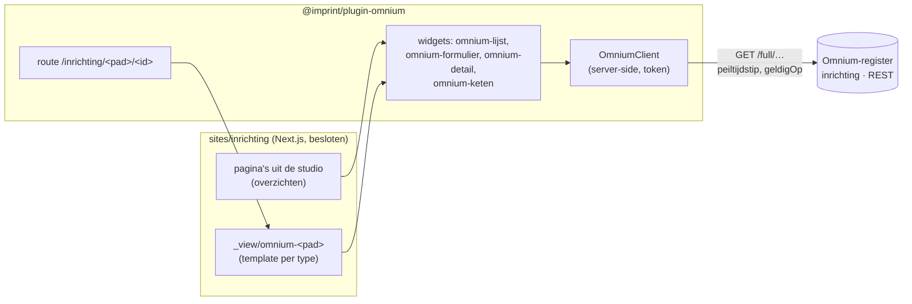

# Imprint als inrichtings-UI op het Omnium-register (ontwerp)

> Ontwerp, 2 november 2026. Vraag van Mark via INRICHTEN_VIZ: een UI voor het
> inrichten van e-diensten (Common Ground, Fundament) als Imprint-site met
> widgets, niet als losse custom site. Nog niets gebouwd; dit stuk is de basis
> voor het besluit en de fasering. Bronnen aan de Omnium-kant staan in de
> Bitemporal-repo (`bitemp_register_v06`): `docs/FORMULIERDEFINITIES.md`,
> `docs/PUBLICATIE_TEMPLATES.md`, `docs/API_REFERENCE.md`,
> `docs/AUTH_DEVELOPER_GUIDE.md`, `docs/TRANSFORMATIES.md` §11 en het plan
> `docs/plans/2026-10-22 Omnium op Fundament — inrichting van e-diensten`.

## 1. Wat het moet doen

Een overzicht van e-diensten (eerst de demo-omgeving cg-test, later per
gemeente), en daarvandaan doorklikken naar alles wat bij een e-dienst hoort:

- de **versies** (EDienstVersie) met hun canonieke model, BPMN/DMN,
  formulierdefinitie en transformaties;
- de **artefacten** die daaruit zijn gemaakt, met hun inhoud (JSON) en
  herkomst (traceregels);
- de **uitrollen** van die artefacten naar **componenten** in een
  **omgeving**, met verloop en resultaat.

Alle gegevens staan in het inrichtingsregister: een Omnium-register (domein
`inrichting`, bitemporele REST-API) op Fundament. De UI leest; schrijven
(inrichten vanuit de UI) is een latere stap (§8).

## 2. Opzet in één beeld

Drie delen, elk met een eigen rol:

1. **`@imprint/plugin-omnium`** — generiek, voor elke site met een
   Omnium-register: de client, de widgets en de doorklikroute. Niets
   inrichtingsspecifieks.
2. **`sites/inrichting`** — de besloten site: login, huisstijl (NL Design
   System), menu en de pagina's, samengesteld in de studio.
3. **Het register** — ongewijzigd, op een paar wensen na (§7).

## 3. `@imprint/plugin-omnium`

### 3.1 De client (server-side)

`OmniumClient` praat alleen vanaf de server met het register; een token komt
nooit in de browser.

- **Configuratie** per site: `omnium: { url, token }` uit de omgeving
  (`OMNIUM_REGISTER_URL`, `OMNIUM_REGISTER_TOKEN`). Los van `OMNIUM_URL`, dat
  naar de Studio/render-API wijst.
- **Lezen** via de geneste weergave, die de veldpaden van de definities
  volgt:
  - `GET /full/<pad>?page=&size=` (antwoord `{<meervoud>: [...], page, size,
    has_more, total_count}`, size tot 2000);
  - `GET /full/<pad>/<id>`;
  - tijdreizen: `peiltijdstip` (formele tijd) en `geldigOp` (materiële tijd),
    gevuld uit Imprints as-of-voorvertoning (`readOptions.asOf`), zodat
    "Tijdreizen" in de admin ook het register laat terugreizen.
- **Actueel bepalen**: een full-record geeft per gegevenselement en relatie
  hubs met versies (`{rel_id, opvoer, afvoer, einde?, data:[…]}`); de client
  kiest per element de actuele versie, met dezelfde regel als Omnium
  (`web/vite/src/shared/actueleData.js`): niet-afgevoerde hub, laatst
  opgevoerde wint. Zonder `peiltijdstip` geeft `/full` ook afgevoerde records:
  de client filtert die standaard weg.
- **Fouten**: de leesroutes geven `{"error": …}` of `{"message": …}`, andere
  routes `application/problem+json`; de client maakt van beide één fout met
  status en tekst, en een widget toont die rustig in plaats van de pagina te
  breken.
- **Cache**: per verzoek (`no-store`) voor records; definities en
  referentielijsten 60 s (ze veranderen zelden).

### 3.2 Definities: Omnium volgen

Zoals besloten in [fase 3 §5–6](fase-3-admin-toegang-tijdreizen.md): Imprint
verzint geen eigen formulier- of lijstformaat maar leest Omnium's
definities, uit hetzelfde register.

- **LijstDefinitie** (`/full/lijst_definities`): `lijst_config_json` =
  `{kolommen: [{veldpad, label, breedte, sorteerbaar, filterbaar}],
  standaardSortering, rijenPerPagina}`, plus het formulier dat bij een rij
  hoort.
- **WeergaveDefinitie** (`/full/weergave_definities`): `tabel_config_json`
  (zelfde vorm) en een detailsjabloon in Markdown met `{{veldpad}}`.
- **FormulierDefinitie** (`/full/formulier_definities`): `layout_json`, een
  boom van `formulier`, `groep`, `rij`, `veld` (pad `ENT.rol.veld`, widget,
  label), `conditioneel` en `lijst`.
- **Welke bij een type hoort**: zoals Omnium's eigen client het doet — de
  actuele `Meta` met `doeltype` = de typenaam, `status` = actief en
  `is_standaard`; een widget kan een andere kiezen met `definitie` (id of
  `code`).

### 3.3 Widgets

| Widget | Doet | Config |
|---|---|---|
| `omnium-lijst` | rendert een type als tabel volgens zijn LijstDefinitie; rijen linken door (§3.4); kolommen sorteren en filteren | `pad`, `definitie?`, `filter?` (vaste voorwaarde, bv. de e-dienst van het onderwerp) |
| `omnium-detail` | rendert één record met het detailsjabloon van zijn WeergaveDefinitie (Markdown, `{{veldpad}}`); zonder sjabloon de velden als definitielijst | `pad?`, `id?` (anders het onderwerp) |
| `omnium-formulier` | rendert één record **alleen-lezen** in de vorm van zijn FormulierDefinitie (groepen, rijen, lijsten; condities toegepast) | `pad?`, `id?`, `definitie?` |
| `omnium-keten` | de keten van een e-dienst als diagram: EDienst → versies → artefacten → uitrollen → componenten, met status | `id?` (anders het onderwerp) |
| `json-boom` | inklapbare JSON-weergave, voor de inhoud van een artefact | `veldpad` in het onderwerp, of `json` — generiek, dus in `widgets-standard` |

Bestaande widgets die meedoen: `v3model` voor het canonieke model (via de
render-API), `mermaid`, `embed` (bv. een Open Formulieren-preview). Een
BPMN/DMN-viewer is een latere widget (bpmn-js, als client-eiland).

**Sorteren en filteren**: `/full` kent geen `q`, `filter` of `sort`
(alleen de platte route `GET /<pad>` heeft `?q=`, `?filter.<kolom>=`,
`?sort=&order=`). Voor de eerste versie haalt `omnium-lijst` een type in één
keer op (size tot 2000; de inrichting is klein) en sorteert en filtert in de
browser. Groeit het, dan vraagt het register filter en sort op `/full` (§7).

### 3.4 Doorklikken: route + template per type

De plugin claimt via `publicRoute` het voorvoegsel (standaard `inrichting`):

- `/inrichting/<pad>/<id>` → haalt het record (`/full/<pad>/<id>`) en rendert
  de templatepagina **`_view/omnium-<pad>`** met het record als onderwerp
  (`subject`), met de bestaande engine-`DefaultView`. Het onderwerp gaat al
  naar elke widget; `omnium-detail`, `omnium-formulier`, `omnium-keten` en
  `omnium-lijst` (met `filter` op het onderwerp) gebruiken het.
- Bestaat de template niet, dan toont de route `omnium-detail` als terugval.
- De templates stel je samen in de studio, zoals elke pagina: de redactie
  bepaalt per type de opbouw, de URL's zijn deelbaar.

Geen querystrings (`?id=3`): een parameter in het pad houdt de pagina's en de
templates eenvoudig, en de route is per definitie dynamisch.

## 4. `sites/inrichting`

- Een nieuwe site, naast musicbrain, imprint, commonground en omnium:
  dezelfde opbouw (`imprint.config.ts`, `src/widgets/*`, admin, studio).
- **Besloten**: de `(site)`-layout eist een sessie en stuurt anders naar
  inloggen; alle publieke routes zijn `force-dynamic` (geen SSG, dus ook geen
  database nodig tijdens de build).
- **Huisstijl**: NL Design System (Utrecht-CSS), passend bij Omnium's
  formulieren en bij de gemeentelijke context.
- **Pagina's** (studio): Overzicht (`omnium-lijst` op `ediensten`), per
  omgeving, en de templates `_view/omnium-ediensten`, `…-edienstversies`,
  `…-artefacten`, `…-uitrollen`, `…-componenten`.
- **Gemeente/omgeving**: een eerste versie toont cg-test; per gemeente wordt
  later een filter (`Omgeving`) of een site-instelling (§7).

Niet in `sites/commonground`: dat is een publieke showcase voor een ander
publiek, met eigen leden; de inrichting is een werkplek.

## 5. Toegang

**Fase A — nu mogelijk:**

- Inloggen in de site met Imprint-accounts (sessiecookie, rollen); de hele
  site alleen voor ingelogden, de PDP van Imprint beslist wie welke pagina
  ziet.
- De site leest het register met **één technisch account**: een persoonlijk
  API-token (`Authorization: Bearer omt_…`) van een register-gebruiker met
  de rol *lezer*, als geheim in de site (`OMNIUM_REGISTER_TOKEN`). Omnium kent
  (nog) geen apart serviceaccount (§7).
- Server-side, dus geen CORS-wijziging in het register nodig.

**Fase B — later:** één identiteit voor site en register via OIDC (op
Fundament ligt een Keycloak voor de hand), met token exchange naar het
register, zodat Omnium's eigen PDP (Toegang op beleid, `TOEGANG_BUNDEL`, per
veld) per gebruiker beslist. Dat vraagt OIDC-login in Imprint (er is nu
alleen een lokale login) en aan de registerkant het subject uit het token.

## 6. Op Fundament (Kubernetes)

Wat er al is: één image per site uit de root-`Dockerfile` (build-arg `SITE`,
Next standalone) en het tools-image voor migraties en scripts. Nodig:

- **Postgres** voor de site (accounts, pagina's, versies): beheerd of in het
  cluster, een eigen database.
- **Geheimen**: `DATABASE_URL`, `SESSION_SECRET`, `OMNIUM_REGISTER_URL`,
  `OMNIUM_REGISTER_TOKEN`, eventueel `OMNIUM_URL` (render-API) en
  `ASSET_S3_*` (anders een PVC voor `ASSET_ROOT`).
- **Jobs**: migraties (`npm run db:migrate:pg`) en het eerste account
  (`npm run user -- add …`) met het tools-image.
- **Ingress** met TLS in plaats van Caddy; geen GoAccess, geen `deploy.sh`.
- **Manifesten of een Helm-chart** in `deploy/k8s/` (bestaan nog niet).
- **Build**: omdat de site per verzoek rendert, bouwt een gewone CI-build
  zonder database (anders dan op de VPS, waar de SSG-build de database leest).
- Sessies staan in een cookie: meerdere replica's kunnen.

## 7. Open punten

Voor Mark:

1. Akkoord met de opzet: plugin-omnium + sites/inrichting, eerst alleen-lezen?
2. Het technische leesaccount in het register: welke gebruiker, en mag het
   een persoonlijk token zijn tot er serviceaccounts zijn?
3. Staat `AUTH_ENABLED` aan op `omnium.fundament.common-ground-lab.nl`, en
   welke `LEESTOEGANG`? (Met `documenten` blijven definities en
   referentielijsten open, records niet.)
4. Gemeente/omgeving: eerst alleen cg-test, of meteen kiesbaar?
5. Waar draait de site op Fundament (namespace, domein, database)?

Wensen aan het register (Omnium), geen voorwaarde voor fase A:

- filter, sortering en `q` op `/full/<pad>` (nu alleen op de platte route);
- een endpoint "standaarddefinitie voor doeltype" (nu bepaalt elke client
  het zelf);
- problem+json ook op de leesroutes;
- serviceaccounts naast persoonlijke tokens.

## 8. Fasering

1. **plugin-omnium, lezen**: client (full, tijdreizen, actueel, fouten),
   definities ophalen, widgets `omnium-lijst` en `omnium-detail`, de route
   met `_view`-templates; tests tegen een vastgelegde respons (fixture
   `cg-test`).
2. **sites/inrichting**: besloten site, huisstijl, overzicht en templates
   voor de vijf hoofdtypen; lokaal tegen het register (token).
3. **`omnium-formulier`** (alleen-lezen, `layout_json`), **`omnium-keten`**,
   **`json-boom`** (widgets-standard).
4. **Fundament**: Helm-chart, uitrol, eerste account.
5. Later: BPMN/DMN-viewer; schrijven via het register (formulier bewerkbaar,
   `/registratie/`); OIDC (fase B).

Niet in dit ontwerp: het register zelf wijzigen, Omnium's Studio vervangen,
of inrichtingsgegevens in Imprint kopiëren — Imprint toont, het register blijft
de bron.
