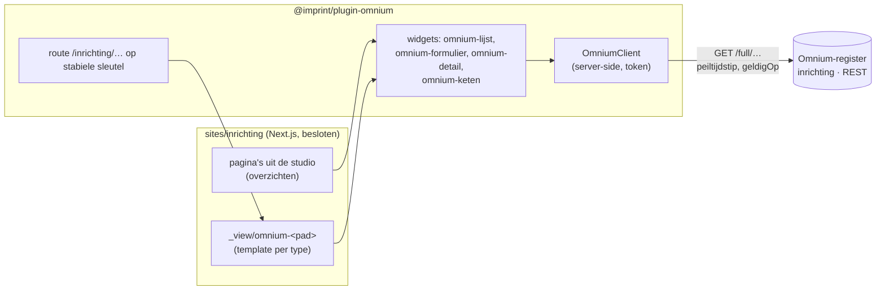

# Imprint als inrichtings-UI op het Omnium-register (ontwerp)

> Ontwerp, 2 november 2026. Vraag van Mark via INRICHTEN_VIZ: een UI voor het
> inrichten van e-diensten (Common Ground, Fundament) als Imprint-site met
> widgets, niet als losse custom site. Nog niets gebouwd; dit stuk is de basis
> voor het besluit en de fasering. Bronnen aan de Omnium-kant staan in de
> Bitemporal-repo (`bitemp_register_v06`): `docs/FORMULIERDEFINITIES.md`,
> `docs/PUBLICATIE_TEMPLATES.md`, `docs/API_REFERENCE.md`,
> `docs/AUTH_DEVELOPER_GUIDE.md`, `docs/TRANSFORMATIES.md` §11 en het plan
> `docs/plans/2026-10-22 Omnium op Fundament — inrichting van e-diensten`.
> Het schermontwerp van INRICHTEN_VIZ staat in de Fundament-repo:
> `docs/inrichtings-ui-ontwerp.md` (§4 schermen, §5 wat het register nodig
> heeft); de aanvullingen daaruit zijn hieronder verwerkt.

## 1. Wat het moet doen

Een overzicht van e-diensten (eerst de demo-omgeving cg-test, later per
gemeente), en daarvandaan doorklikken naar alles wat bij een e-dienst hoort:

- de **versies** (EDienstVersie) met hun canonieke model, BPMN/DMN,
  formulierdefinitie en transformaties;
- de **artefacten** die daaruit zijn gemaakt, met hun inhoud (JSON) en
  herkomst (traceregels);
- de **uitrollen** van die artefacten naar **componenten** in een
  **omgeving**, met verloop en resultaat.

Alle gegevens staan in het inrichtingsregister: een Omnium-register (domein
`inrichting`, bitemporele REST-API) op Fundament. De UI leest; schrijven
(inrichten vanuit de UI) is een latere stap (§8).

## 2. Opzet in één beeld

Drie delen, elk met een eigen rol:

1. **`@imprint/plugin-omnium`** — generiek, voor elke site met een
   Omnium-register: de client, de widgets en de doorklikroute. Niets
   inrichtingsspecifieks.
2. **`sites/inrichting`** — de besloten site: login, huisstijl (NL Design
   System), menu en de pagina's, samengesteld in de studio.
3. **Het register** — ongewijzigd, op een paar wensen na (§7).

## 3. `@imprint/plugin-omnium`

### 3.1 De client (server-side)

`OmniumClient` praat alleen vanaf de server met het register; een token komt
nooit in de browser.

- **Configuratie** per site: `omnium: { url, token }` uit de omgeving
  (`OMNIUM_REGISTER_URL`, `OMNIUM_REGISTER_TOKEN`). Los van `OMNIUM_URL`, dat
  naar de Studio/render-API wijst.
- **Lezen** via de geneste weergave, die de veldpaden van de definities
  volgt:
  - `GET /full/<pad>?page=&size=` (antwoord `{<meervoud>: [...], page, size,
    has_more, total_count}`, size tot 2000);
  - `GET /full/<pad>/<id>`;
  - de sleutel van de lijst in het antwoord is het meervoud **met spatie**
    (`{"lijst definities": [...]}`): de client neemt de enige array-sleutel,
    niet de padnaam;
  - relaties lopen via relatie-entiteiten (`ArtefactEdienstversie`,
    `UitrolEdienstversie`, `UitrolOmgeving`, `ArtefactDoelcomponent`,
    `EdienstversieEdienst`). "De artefacten van deze versie" is daarom een
    filter over een relatie; de client gebruikt daarvoor
    `GET /api/volgorde/<pad>?via=<relatie>&doel=<id>[&na=<afhankelijkheid>]`,
    dat ze meteen in uitrolvolgorde geeft;
  - tijdreizen: `peiltijdstip` (formele tijd) en `geldigOp` (materiële tijd),
    gevuld uit Imprints as-of-voorvertoning (`readOptions.asOf`), zodat
    "Tijdreizen" in de admin ook het register laat terugreizen.
- **Actueel bepalen**: een full-record geeft per gegevenselement en relatie
  hubs met versies (`{rel_id, opvoer, afvoer, einde?, data:[…]}`); de client
  kiest per element de actuele versie, met dezelfde regel als Omnium
  (`web/vite/src/shared/actueleData.js`): niet-afgevoerde hub, laatst
  opgevoerde wint. Zonder `peiltijdstip` geeft `/full` ook afgevoerde records:
  de client filtert die standaard weg.
- **Fouten**: de leesroutes geven `{"error": …}` of `{"message": …}`, andere
  routes `application/problem+json`; de client maakt van beide één fout met
  status en tekst, en een widget toont die rustig in plaats van de pagina te
  breken.
- **Cache**: per verzoek (`no-store`) voor records; definities en
  referentielijsten 60 s (ze veranderen zelden).

### 3.2 Definities: Omnium volgen

Zoals besloten in [fase 3 §5–6](fase-3-admin-toegang-tijdreizen.md): Imprint
verzint geen eigen formulier- of lijstformaat maar leest Omnium's
definities, uit hetzelfde register.

- **LijstDefinitie** (`/full/lijst_definities`): `lijst_config_json` =
  `{kolommen: [{veldpad, label, breedte, sorteerbaar, filterbaar}],
  standaardSortering, rijenPerPagina}`, plus het formulier dat bij een rij
  hoort.
- **WeergaveDefinitie** (`/full/weergave_definities`): `tabel_config_json`
  (zelfde vorm) en een detailsjabloon in Markdown met `{{veldpad}}`.
- **FormulierDefinitie** (`/full/formulier_definities`): `layout_json`, een
  boom van `formulier`, `groep`, `rij`, `veld` (pad `ENT.rol.veld`, widget,
  label), `conditioneel` en `lijst`.
- **Nog geen definities**: in het register op Fundament stonden op 2-11 nul
  lijst-, weergave- en formulierdefinities, en na de herbouw van 5-11 zijn de
  antwoorden zo klein (75 en 79 bytes) dat ze vermoedelijk nog leeg zijn. Elke widget heeft daarom een
  **automatische weergave** als terugval: kolommen en velden uit het model
  (`/api/viz/schema`), de gegevenselementen van het eerste niveau, de
  weergavenaam van relaties. Zodra er definities zijn (via replay), nemen die
  het over.
- **Welke bij een type hoort**: zoals Omnium's eigen client het doet — de
  actuele `Meta` met `doeltype` = de typenaam, `status` = actief en
  `is_standaard`; een widget kan een andere kiezen met `definitie` (id of
  `code`).

### 3.3 Widgets

| Widget | Doet | Config |
|---|---|---|
| `omnium-lijst` | rendert als tabel volgens de LijstDefinitie (of automatisch): **een type**, **de records die via een relatie aan het onderwerp hangen** (volgorde-endpoint), of **een lijst binnen het onderwerp**: een meervoudig gegevenselement, zoals de traceregels van een artefact (`ArtefactTraceregel`: bronGE, regel, doelPad, actie), of een meervoudige relatie met eigen velden, zoals de resultaten van een uitrol (`uitrol_resultaten`: artefact_id, actie, tijdstip, payloadHash, doelUrl, doelVersie, melding); rijen linken door (§3.4), die van `uitrol_resultaten` naar het artefact; sorteren en filteren | `pad` of `via`+`relatie` of `veldpad` (GE of relatie in het onderwerp), `definitie?` |
| `omnium-detail` | rendert één record met het detailsjabloon van zijn WeergaveDefinitie (Markdown, `{{veldpad}}`); zonder sjabloon de velden als definitielijst | `pad?`, `id?` (anders het onderwerp) |
| `omnium-formulier` | rendert één record **alleen-lezen** in de vorm van zijn FormulierDefinitie (groepen, rijen, lijsten; condities toegepast) | `pad?`, `id?`, `definitie?` |
| `omnium-keten` | de keten van een e-dienst als diagram: EDienst → versies → artefacten → uitrollen → componenten, met status | `id?` (anders het onderwerp) |
| `omnium-inhoud` | de inhoud van een artefact, in de weergave die bij zijn **artefactsoort** hoort: objecttype en zaaktype als JSON-boom, BPMN (en later DMN) met een viewer, een Open Formulieren-definitie als formuliervoorbeeld | `veldpad?` (anders de inhoud van het onderwerp) |
| `json-boom` | inklapbare JSON-weergave; de basis onder `omnium-inhoud` | generiek, dus in `widgets-standard` |
| `bpmn-viewer` | BPMN-XML als diagram (bpmn-js NavigatedViewer, client-eiland; Omnium's Inhoud Editor gebruikt dezelfde, sinds 1f4f59e5, bpmn-js 17.11.1) | `xml` of `veldpad` |

Bestaande widgets die meedoen: `v3model` voor het canonieke model (via de
render-API), `mermaid`, `embed` (bv. een Open Formulieren-preview).

Aandachtspunten:

- **Canoniek model**: een e-dienstversie noemt haar bronmodel nu als tekst
  plus hash (`bronmodelVersie`), niet als modelnaam en -versie in Omnium. Tot
  er een koppeling is, krijgt `v3model` per template vaste config; het
  gebruikte deel van het model volgt uit de `bronGE`'s van de traceregels.
  Over domeinen heen tekenen kan (`taal=v3`): met een `diagram` dat
  entiteiten uit beide domeinen bevat, of met `domein`, waarbij buren uit een
  ander domein als gestippelde stomp verschijnen. Zonder een van beide geeft
  een model met meer domeinen 400. Zo staat de GPK-aanvraag naast de generieke
  Aanvraag.
- **Keten**: `omnium-keten` bedenkt de koppelingen niet opnieuw maar volgt de
  regels uit de Fundament-repo (`scripts/inrichting-export.ps1`): plaatshouders
  `${OBJECTTYPE_URL:<id>}` gaan naar Open Object, `catalogue` (bijlagen) naar
  de Documenten-API van Open Zaak; de tekening en de modi *inrichten* en
  *aanvraag* naar `visualisatie/inrichting.html`.
- **Transformaties**: zolang ze geen records zijn, staan `regelsetId`,
  `regelsetVersie` en `schrijverId` in de herkomst van elk artefact
  (bv. `canoniek-naar-objecttype` 0.4.0); de tab Transformaties groepeert de
  artefacten van een versie daarop.
- **Uitrol**: per resultaat de actie (aangemaakt, nieuwe versie, ongewijzigd)
  als status, en `doelUrl` als link naar het object in de component.

**Sorteren en filteren**: `/full` kent geen `q`, `filter` of `sort`
(alleen de platte route `GET /<pad>` heeft `?q=`, `?filter.<kolom>=`,
`?sort=&order=`). Voor de eerste versie haalt `omnium-lijst` een type in één
keer op (size tot 2000; de inrichting is klein) en sorteert en filtert in de
browser. Groeit het, dan vraagt het register filter en sort op `/full` (§7).

### 3.4 Doorklikken: route + template per type

De plugin claimt via `publicRoute` het voorvoegsel (standaard `inrichting`):

- `/inrichting/…` → herleidt de stabiele sleutel in het pad (hieronder) tot een
  record, haalt het (`/full/<pad>/<id>`) en rendert
  de templatepagina **`_view/omnium-<pad>`** met het record als onderwerp
  (`subject`), met de bestaande engine-`DefaultView`. Het onderwerp gaat al
  naar elke widget; `omnium-detail`, `omnium-formulier`, `omnium-keten` en
  `omnium-lijst` (met `filter` op het onderwerp) gebruiken het.
- Bestaat de template niet, dan toont de route `omnium-detail` als terugval.
- De templates stel je samen in de studio, zoals elke pagina: de redactie
  bepaalt per type de opbouw, de URL's zijn deelbaar.

Geen querystrings (`?id=3`): een parameter in het pad houdt de pagina's en de
templates eenvoudig, en de route is per definitie dynamisch.

**Stabiele sleutels, geen id's.** De id's van het register overleven een nieuwe
eerste vulling niet. Bij het vervangen van de cg-test-nodes op 3-11 ging de
database verloren; de herbouw van 5-11 nummerde alles opnieuw (de GPK-versie was
3 en is nu 2, de artefacten waren 2-13 en zijn nu 1-12) en de historie van vóór
3-11 is weg. URL's, templates
en widgetconfig noemen daarom geen id. Slechts een deel van de typen heeft een
eigen sleutel (bron: `docs/inrichting-domein-v3.json` en de export van 29-10 in
de Fundament-repo; of het register "uniek" ook afdwingt, is nog niet getest):

| Type | Sleutel | Route onder `/inrichting` | Let op |
|---|---|---|---|
| componenten | `ComponentNaam.naam` | `/componenten/<naam>` | korte namen (gzac, openzaak) |
| ediensten | `EdienstNaam.naam` | `/ediensten/<naam>` | vrije tekst met spaties en haakjes, dus URL-gecodeerd; **hernoemen breekt de link** |
| edienstversies | e-dienst + `versienummer` | `/ediensten/<naam>/versies/<versienummer>` | het nummer alleen is niet uniek; de e-dienst loopt via `EdienstversieEdienst` |
| artefacten | soortcode + doelcomponent + `identifier` | `/artefacten/<soortcode>/<component>/<identifier>` | `identifier` alleen is niet uniek; van de soort de `code`, want de id van de referentielijst verschilt per instantie; de component loopt via `ArtefactDoelcomponent` |
| uitrollen | geen; `gestartOp` is praktisch uniek, niet gegarandeerd | `/ediensten/<naam>/versies/<versienummer>/uitrollen/<gestartOp>` | een uitrol is een gebeurtenis en komt na een nieuwe vulling niet terug: deze links gelden alleen binnen dit register |

De route is dus niet overal `<pad>/<sleutel>`: de plugin kent per type zijn
routevorm en hoe die naar een id wordt herleid. De template blijft
`_view/omnium-<pad>`.

**Sleutel naar id** kan niet met één filter:

- `?filter.<kolom>=` op de platte route is een **bevat-zoekopdracht**
  (`ILIKE '%waarde%'`, hoofdletterongevoelig, `%` en `_` lijken als jokerteken te
  werken; `handlers/core_handlers.go` in Omnium). `filter.versienummer=0.1` vindt
  ook `0.1.0` en `10.1.2`. De client controleert elke treffer daarom zelf exact,
  over alle pagina's van het antwoord. Geen exacte treffer is een 404, meer dan
  één een zichtbare fout, nooit een willekeurig record.
- Samengestelde sleutels lopen via relaties, dus dat zijn meerdere stappen (eerst
  de e-dienst of component, dan via `/api/volgorde` of de lijst), of de lijst
  ophalen en in de client matchen.
- Nog na te gaan: welke kolommen de platte route toelaat (een onbekende geeft
  400), dus of velden uit de gegevenselementen filterbaar zijn. Zo niet, dan is
  ophalen en matchen de enige weg.

Doorlinken vanuit een rij (bv. `artefact_id` in `uitrol_resultaten`) bouwt de URL
uit de sleutel van het doelrecord; de id blijft binnen de client.

### 3.5 Bronnen: waaruit is het gemaakt (voorstel)

Mark modelleert per e-dienst (en sub-e-dienst) in een Omnium-project: logisch
model, BPMN, DMN, CMMN en formulierdefinities. Nu kent het register alleen wat
daaruit **gemaakt** is; de bron is tekst plus hash (`bronmodelVersie`). Voorstel
(afgestemd met INRICHTEN_VIZ, 5-11; Mark beslist):

Drie backends, elk met een eigen rol:

| Backend | Rol |
|---|---|
| Omnium-project (Omnium-backend) | de werkplek: levend, meerdere gebruikers in sync, snapshots maar geen fijnmazige historie |
| Inrichtingsregister | de vastgelegde stand: wat is waaruit gemaakt en waar uitgerold, bitemporeel |
| Imprint-backend | alleen pagina's, templates en accounts van de inrichtings-UI; geen kopie van inrichtingsgegevens |

- **Bronnen zijn artefacten**, geen apart type: Artefact heeft al identificatie,
  inhoud met hash, de relatie naar de e-dienstversie en historie, en de widgets
  werken dan ongewijzigd. In het model: `richting` (bron | gegenereerd) op
  `ArtefactSoortGegevens`; nieuwe soorten `logisch-model`, `bpmn-bron`,
  `dmn-bron`, `cmmn-bron`, `formulierdefinitie-bron` (de achtervoegsels
  voorkomen botsing met de bestaande gegenereerde BPMN en DMN); formaten
  Omnium-JSON en SVG.
- **Herkomst naar de bron**: een relatie `ArtefactBron` (gegenereerd → bron,
  meervoudig, met `rol`). `bronmodelHash` wordt controleerbaar tegen de
  `payloadHash` van de bron, en `bronmodelVersie` als tekst kan op termijn weg.
  `bronGE` in een traceregel wijst naar een element-id in die bron.
- **Sub-e-diensten**: relatie EDienst → EDienst ("onderdeel van").
- **Snapshot bij elke transformatie**, per e-dienstmap (niet het hele
  project), als **Studio-projectexport** (`{formaat, project, profielen}`), met een hash over die deelverzameling: is de bron ongewijzigd, dan
  wordt het bestaande bronartefact hergebruikt. De export van de stap
  "Inrichtingsartefacten" neemt de bronbestanden op en
  `scripts/omnium-registreer-artefact.ps1` (Fundament-repo) registreert ze vóór
  de gegenereerde.
- **Diagrammen als SVG**, gerenderd door de render-API tijdens de transformatie,
  uit dezelfde snapshot (bron-JSON en SVG hebben dus één oorsprong). Vastgelegd
  als eigen artefact (formaat SVG, afhankelijkheid "weergave van" de bron),
  **met de render-versie erbij**: dezelfde invoer geeft byte-gelijke SVG
  (stabiele id's via `idPrefix`), maar de tekening verandert per render-release,
  en zonder versie lijkt een nieuwe tekening een gewijzigde bron. De JSON blijft
  de waarheid. Nog na te gaan: of `ArtefactInhoud` meervoudig mag, dan kan de
  SVG ook als tweede inhoud van het bronartefact.
- **Stand van de render-API** (5-11, `bitemp_register_v06/docs/RENDER_API.md`):
  - `taal=v3` (op Fundament): V3-klassemodellen, via modelnaam
    (`GET /api/models/{naam}/diagram.svg`) of meegestuurde JSON
    (`POST /api/render/svg`).
  - `taal=studio` (render 0.2.0, alleen lokaal, nog geen image op Fundament): alle
    25 Studio-profielen, waaronder canoniek-uml, BPMN, DMN-DRD, CMMN en
    formulier. Alleen `POST` met een Studio-projectexport of één profiel, plus
    `diagram` (id of naam); een GET op een project bestaat niet (projecten zijn
    privé).
  - Het DMN-profiel tekent de **DRD** (beslissingsgraaf), geen beslistabel: een
    beslistabel als bron krijgt geen SVG en wordt een tabel of JSON-boom.
  - **Nog niet bekeken**: BPMN-, DMN-, CMMN- en formuliertekeningen (een deel
    van de vormen valt terug op zeven basisvormen, tekst kan buiten een vak
    lopen; OMNIUM-UI werkt eraan), en `taal=studio` over pakketten heen.
  - Er hoeft dus niets nieuws gebouwd te worden; wel nodig zijn een image van
    render 0.2.0 op Fundament en een kwaliteitscheck van die tekeningen.
- **Kanttekening**: zolang het Omnium-project geen fijnmazige historie heeft, is
  de snapshot in het register de enige historische bron. Een bron die niet door
  een transformatie ging, staat er niet in.

Gevolgen voor Imprint:

- De pagina van een e-dienstversie krijgt een tab **Bronnen** naast Artefacten
  (`omnium-lijst` op artefacten met `richting=bron`), met per gegenereerd
  artefact een link naar zijn bron.
- `omnium-inhoud` toont een bron in **Omnium-JSON** via de SVG-weergave (bpmn-js
  kan Omnium's eigen formaat niet lezen) en de JSON als boom eronder; een
  beslistabel als tabel. Gegenereerde BPMN 2.0- en DMN-XML leest de render-API
  niet: die blijft via bpmn-js en een DMN-viewer lopen.

Wie wat doet:

| Onderdeel | Bij |
|---|---|
| Inrichtingsmodel (soorten, `richting`, `ArtefactBron`, EDienst → EDienst) | TRANSFORMATIES en Mark |
| Snapshot per e-dienstmap in de transformatie | TRANSFORMATIES / Omnium |
| SVG renderen (`taal=studio`): image op Fundament, kwaliteit van BPMN/DMN/CMMN/formulier | RENDER-API, OMNIUM-UI |
| Registratiescript met bronbestanden | INRICHTEN_VIZ (Fundament-repo) |
| Tab Bronnen, weergave in `omnium-inhoud` | Imprint (deze notitie) |

## 4. `sites/inrichting`

- Een nieuwe site, naast musicbrain, imprint, commonground en omnium:
  dezelfde opbouw (`imprint.config.ts`, `src/widgets/*`, admin, studio).
- **Besloten**: de `(site)`-layout eist een sessie en stuurt anders naar
  inloggen; alle publieke routes zijn `force-dynamic` (geen SSG, dus ook geen
  database nodig tijdens de build).
- **Huisstijl**: NL Design System (Utrecht-CSS), passend bij Omnium's
  formulieren en bij de gemeentelijke context.
- **Pagina's** (studio): Overzicht (`omnium-lijst` op `ediensten`), per
  omgeving, en de templates `_view/omnium-ediensten`, `…-edienstversies`,
  `…-artefacten`, `…-uitrollen`, `…-componenten`.
- **Gemeente/omgeving**: een eerste versie toont cg-test; per gemeente wordt
  later een filter (`Omgeving`) of een site-instelling (§7).

Niet in `sites/commonground`: dat is een publieke showcase voor een ander
publiek, met eigen leden; de inrichting is een werkplek.

## 5. Toegang

**Fase A — nu mogelijk:**

- Inloggen in de site met Imprint-accounts (sessiecookie, rollen); de hele
  site alleen voor ingelogden, de PDP van Imprint beslist wie welke pagina
  ziet.
- Stand op Fundament (2-11): auth staat aan; records geven 401 zonder login,
  definities 200 (`LEESTOEGANG=documenten`). De scripts loggen nu in als
  admin; **dat wachtwoord hoort niet in de site**.
- De site leest het register met **één technisch account**: een persoonlijk
  API-token (`Authorization: Bearer omt_…`) van een register-gebruiker met
  de rol *lezer*, als geheim in de site (`OMNIUM_REGISTER_TOKEN`). Omnium kent
  (nog) geen apart serviceaccount (§7).
- Server-side, dus geen CORS-wijziging in het register nodig.

**Fase B — later:** één identiteit voor site en register via OIDC (op
Fundament ligt een Keycloak voor de hand), met token exchange naar het
register, zodat Omnium's eigen PDP (Toegang op beleid, `TOEGANG_BUNDEL`, per
veld) per gebruiker beslist. Dat vraagt OIDC-login in Imprint (er is nu
alleen een lokale login) en aan de registerkant het subject uit het token.

## 6. Op Fundament (Kubernetes)

Voorbereid (5-11): manifesten in `deploy/k8s/` (kustomize), met een
server-side dry-run tegen het cluster gecontroleerd; runbook in
[../deploy-fundament.md](../deploy-fundament.md). Ze volgen hoe Omnium er draait:

- namespace `tnt-cg--inrichting`, hostnaam
  `inrichting.fundament.common-ground-lab.nl` (werktitels);
- een HTTPRoute op de gedeelde Gateway `web`, TLS uit het gedeelde certificaat;
- een eigen database in het CloudNativePG-cluster `pg-main` (`tnt-cg--db`);
- uploads in een Ceph-bucket (ObjectBucketClaim), niet op een node-lokaal
  volume;
- het register en de render-API binnen het cluster (`omnium-api`,
  `omnium-render-svc`), geen omweg via de gateway;
- migraties als Job met het tools-image; geheimen alleen in een Secret die je
  met de hand maakt;
- de image bouwt zonder database (de site rendert per verzoek), dus ook in CI.

Nog te doen bij FUNDAMENT, want het raakt gedeelde objecten: de namespace, de
rol in `pg-main`, de hostnaam in het certificaat. En de vraag of `pg-main`
backups heeft.

## 7. Open punten

Voor Mark:

1. ~~Akkoord met de opzet?~~ Ja (5-11).
2. ~~Leesaccount?~~ Een gebruiker met de rol *lezer* en een persoonlijk token
   tot er serviceaccounts zijn (5-11); gevraagd aan INRICHTEN_VIZ.
3. ~~Staat auth aan?~~ Ja, ook na de herbouw (5-11): records geven 401 zonder
   login, definities 200. Nodig: een leesaccount met de rol *lezer* en een
   token (`omt_…`) voor de site.
4. Gemeente/omgeving: eerst alleen cg-test, of meteen kiesbaar?
5. ~~Waar op Fundament?~~ `tnt-cg--inrichting`,
   `inrichting.fundament.common-ground-lab.nl`, database `inrichting` in
   `pg-main` (5-11); gevraagd aan FUNDAMENT. Backups: dagelijkse `pg_dump` per
   database naar een bucket, 30 dagen; `inrichting` en de uploadbucket moeten
   aan die lijst worden toegevoegd.
6. Modelwens (voorstel van INRICHTEN_VIZ, nog niet met je besproken): een stabiel
   `code`-veld op EDienst en een uuid op Uitrol. Dan overleven links een
   hernoeming en een nieuwe vulling, en vervalt de omweg via naam en `gestartOp`.
   De herbouw is al gebeurd, dus dit wordt een gewone modelwijziging waarbij de
   bestaande records worden ingevuld.
7. Bronnen in het register (§3.5): akkoord met bronnen als artefacten, een
   snapshot per e-dienstmap bij elke transformatie en SVG als afgeleide
   weergave?

Wensen aan het register (Omnium), geen voorwaarde voor fase A:

- filter, sortering en `q` op `/full/<pad>` (nu alleen op de platte route);
- een exact filter naast de bevat-zoekopdracht, met jokertekens ge-escaped;
- een endpoint "standaarddefinitie voor doeltype" (nu bepaalt elke client
  het zelf);
- problem+json ook op de leesroutes;
- serviceaccounts naast persoonlijke tokens;
- lijst-, weergave- en formulierdefinities voor de inrichtingstypen (replay);
- de e-dienstversie met een echte verwijzing naar het bronmodel (naam en
  versie in Omnium);
- de render-API: `taal=studio` (render 0.2.0) als image op Fundament.

## 8. Fasering

1. **plugin-omnium, lezen**: client (full, tijdreizen, actueel, fouten),
   definities ophalen, widgets `omnium-lijst` en `omnium-detail`, de route
   met `_view`-templates; tests tegen een fixture: een vastgelegde `/full`-respons van het
   herbouwde register. De `/full`-sleutels zijn na de herbouw alleen
   steekproefsgewijs gezien (bij een artefact o.a. `artefact_identificaties`,
   `artefact_inhouden`, `artefact_herkomsten`, `artefact_traceregels`,
   `artefact_edienstversies`, `artefact_doelcomponenten`); de rest bij het
   vastleggen controleren tegen de nieuwe schema-versie.
2. **sites/inrichting**: besloten site, huisstijl, overzicht en templates
   voor de vijf hoofdtypen; lokaal tegen het register (token).
3. **`omnium-inhoud`** met **`json-boom`** (widgets-standard) en
   **`bpmn-viewer`** — processen en regels zijn een vast onderdeel, dus niet
   "later" — plus **`omnium-formulier`** (alleen-lezen, `layout_json`) en
   **`omnium-keten`** (regels uit de Fundament-repo).
   Als §3.5 doorgaat: tab Bronnen en de SVG-weergave van bronnen; een
   `dmn-viewer` voor gegenereerde DMN.
4. **Fundament**: Helm-chart, uitrol, eerste account.
5. Later: DMN-viewer; schrijven via het register (formulier bewerkbaar,
   `/registratie/`); OIDC (fase B).

Niet in dit ontwerp: het register zelf wijzigen, Omnium's Studio vervangen,
of inrichtingsgegevens in Imprint kopiëren — Imprint toont, het register blijft
de bron.
